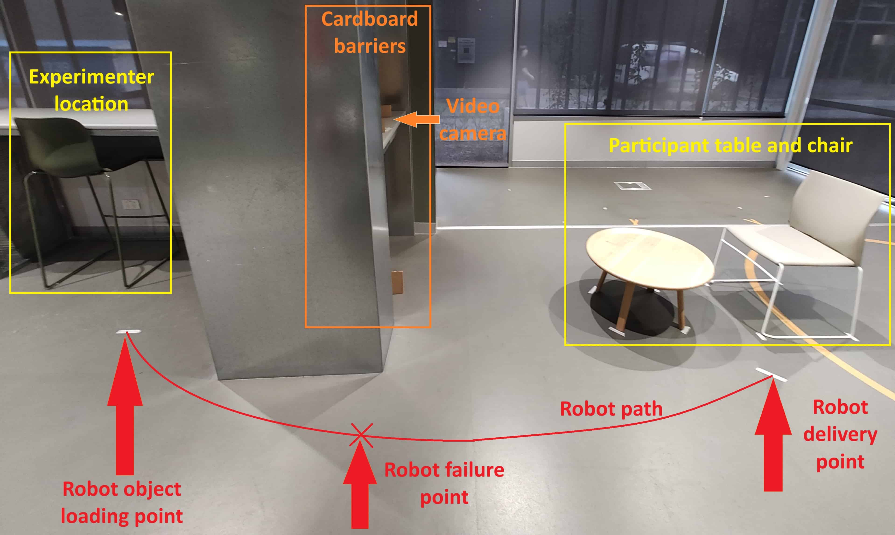
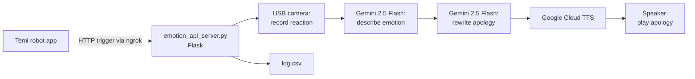

# "I'm Not Mad, Just Focused": VLM Emotion Recognition for Human-Robot Collaboration

Code and results for the IEEE RA-L 2026 paper **"I'm Not Mad, Just Focused": Understanding Human Emotions in Human-Robot Collaboration** by Seung Chan Hong, Dana Kulić and Leimin Tian (Monash University). To be presented at ICRA 2027.

[Paper](https://doi.org/10.1109/LRA.2026.3694591) · [arXiv](https://arxiv.org/abs/2605.16816) · [Full dataset with videos (Monash Bridges)](https://doi.org/10.26180/32197137) · [IEEE Spectrum coverage](https://spectrum.ieee.org/robot-emotions-visual-language-models)

Emotion recognition models used by collaborative robots usually classify a face in isolation, so a frown of concentration reads as anger. This work uses a vision-language model (Gemini 2.5) to describe a person's emotion from the whole scene instead. We tested it in two ways: against human observers on a human-robot handover dataset (Study 1), and live on a Temi service robot that adapts its apology after a failed delivery (Study 2).

<p align="center"></p>

## Results

**Study 1.** 36 handover videos from the FACT-HRC dataset, compared with free-text emotion descriptions from 60 crowdworkers. Alignment is the cosine similarity of [BGE](https://huggingface.co/BAAI/bge-large-en-v1.5) text embeddings, model output vs. averaged human descriptions.

| Model | Output | Similarity to humans (mean ± SD) |
|---|---|---|
| Gemini 2.5 Flash | Free-text description | **0.860 ± 0.040** |
| Gemini 2.5 Pro | Free-text description | 0.852 ± 0.034 |
| Gemini 2.5 Flash, label-only prompt (ablation) | Emotion label + objects | 0.810 ± 0.045 |
| Stacked CNN baseline (DeepFace + YOLOv9c) | Emotion label + objects | 0.771 ± 0.028 |

Both VLMs beat the CNN baseline (one-way ANOVA, Tukey HSD, p < 0.0001). The ablation forces the VLM into the CNN's label format and it still wins, mostly through better object grounding (0.789 vs. 0.771). The VLMs also matched the neutral-to-positive tone of human descriptions, where the CNN skewed negative.

**Study 2.** 40 participants assembled a candy bag with a Temi robot that failed one delivery on purpose. In the emotion-adaptive condition, the server recorded the participant's reaction, Gemini 2.5 Flash described it, and the robot spoke an apology rewritten for that emotion.

- **31 of 40** participants preferred the emotion-adaptive robot (binomial test, p < 0.001).
- Trust fell after the failure in both failure conditions, adaptive apology or not. Users liked the socially aware response, but it didn't repair trust.
- VLM descriptions matched participants' own self-reported emotions less closely than they matched outside observers (0.693 vs. 0.860).
- Measured cloud inference latency: 6.82 s on average.

## How the Study 2 system works



The robot runs a scripted delivery and calls the server's endpoints at each step. `/play_*` plays a message while recording the participant. `/EA_process` runs the emotion-adaptive pipeline, `/NE_process` logs the emotion but keeps the generic apology, and `/control_process` handles the successful-delivery condition.

## Repository layout

```
study1/             VLM descriptions, CNN baseline, text preprocessing, similarity and sentiment
  runtime/          the same Gemini scripts instrumented for latency, plus benchmark_runner.py
study1_ablation/    VLM with the CNN's label-only output format
study2/
  emotion_api_server.py   live server used with the Temi robot
  *.mp3                   delivery message and apology audio the server plays
  analysis/               normality checks, Friedman/Wilcoxon, ANCOVA, Bayesian models, plots
figures/            paper figures
```

Each folder holds its scripts together with the result files they read and write, so scripts are run from inside their folder.

## Running the code

```bash
git clone https://github.com/scdhong/vlm-emotion-recognition-hrc.git
cd vlm-emotion-recognition-hrc
pip install -r requirements.txt
cp keys.env.example study1/keys.env   # add your Gemini API key
```

**Re-run the analysis from the included results** (no API key or videos needed):

```bash
cd study1
python semantic_similarity.py      # BGE similarity: Gemini Flash vs. human annotators
python sentiment_analysis.py       # VADER sentiment comparison
```

Edit the input and output filenames at the top of a script to switch models (for example, `gemini_processed_cells.csv` for Gemini 2.5 Pro or `cnn_processed_cells.csv` for the baseline).

**Regenerate model outputs from the videos:**

1. Download the Study 1 handover clips ("Shortlisted videos") from the [Bridges dataset](https://doi.org/10.26180/32197137) into `study1/videos/`, or set `STUDY1_VIDEO_DIR`.
2. Run `gemini_pro_descriptions.py`, `gemini_flash_descriptions.py` or `stacked_cnn_baseline.py`.
3. Run `preprocess_text.py` (lemmatization, stop-word removal), then `semantic_similarity.py`.

**Study 2 statistics:** the scripts in `study2/analysis/` read the included result spreadsheets. Three of them (`EA_vs_NE.py`, `verify_mann_whitney.py`, `semantic_similarity_analysis.py`) also need participant-level files that are only in the Bridges dataset: the questionnaire responses, observation notes and `log.csv`.

## Data

Participant videos, questionnaire responses, observation notes and the questionnaires themselves are kept in the [Monash Bridges dataset](https://doi.org/10.26180/32197137), not in this repository. The crowdsourced annotations in `study1/` contain only the free-text emotion descriptions; survey metadata has been removed. The studies were approved by the Monash University Human Research Ethics Committee (project 47179).

## Citation

```bibtex
@article{hong2026notmad,
  title   = {"I'm Not Mad, Just Focused": Understanding Human Emotions in Human-Robot Collaboration},
  author  = {Hong, Seung Chan and Kuli{\'c}, Dana and Tian, Leimin},
  journal = {IEEE Robotics and Automation Letters},
  volume  = {11},
  number  = {7},
  year    = {2026},
  doi     = {10.1109/LRA.2026.3694591}
}
```

## License

[CC BY 4.0](LICENSE), matching the Bridges dataset. Study 1 uses videos from the FACT-HRC dataset (Tian et al., HRI 2023).
